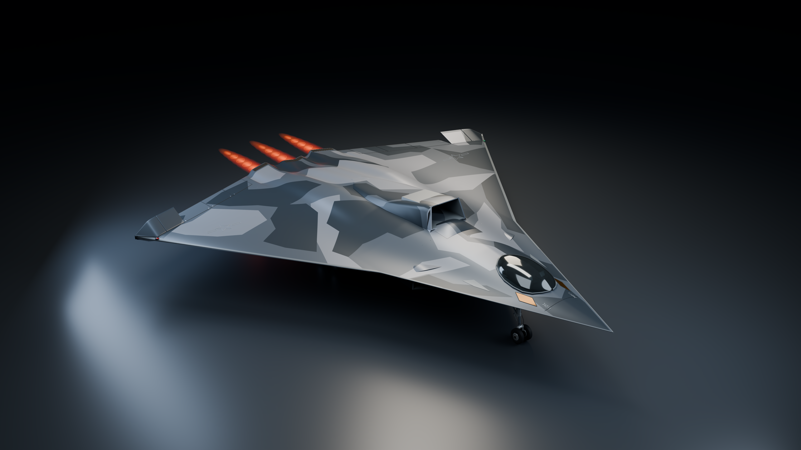

# J-36 · 36011 Blender 外观模型

一个可编辑的 Blender 飞机外观工程，附八张 3840 × 2160、16 位 PNG 渲染图。

[Blender 模型](J36_36011_Master.blend) · [完整说明与参照来源](DELIVERY.md) · [渲染图目录](renders/)

## 本版细节

- 移除机鼻前伸探针，缩小并压低座舱玻璃。
- 重做尾部融合整流体、三处后向喷口暗腔、热防护细节与机腹外形。
- 增加可关闭的红橙尾焰、激波亮节和马赫环视觉效果。
- 保留分组机体、座舱、起落架、外部标记、摄影棚与八个相机。

## 打开与编辑

用 Blender 5.2 LTS 打开 `J36_36011_Master.blend`。主要参考图和迷彩贴图已内嵌，无需另装插件。整体移动飞机时，选择 `00 • Aircraft transform` 集合中的根物体；关闭 `07 • Exhaust effects` 集合的渲染开关即可隐藏尾焰。

`scripts/` 包含建模、材质、尾焰、起落架、渲染与校验脚本。渲染脚本当前使用 macOS Metal；其他平台可直接在 Blender 界面选择对应渲染设备。

## 渲染图

| 视角 | 文件 |
| --- | --- |
| 主视角 | [Hero](renders/J36_36011_Hero_4K.png) |
| 后视 | [Rear](renders/J36_36011_Rear_4K.png) |
| 俯视 | [Top](renders/J36_36011_Top_4K.png) |
| 前视 | [Front](renders/J36_36011_Front_4K.png) |
| 座舱与进气细节 | [Detail](renders/J36_36011_Detail_4K.png) |
| 侧视 | [Side](renders/J36_36011_Side_4K.png) |
| 腹部 | [Ventral](renders/J36_36011_Ventral_4K.png) |
| 喷口与尾焰特写 | [Exhaust](renders/J36_36011_Exhaust_4K.png) |

## 精度与参考

这是依据用户提供的三视图和公开照片制作的视觉模型，没有测绘或官方工程数据，不能验证与原型机“100% 一致”。不可见细节、比例尺和局部结构包含建模近似。尾焰与马赫环是艺术效果，不代表已验证的实机排气状态或物理模拟。

参考图片的来源及使用范围见 [DELIVERY.md](DELIVERY.md)；不将这些图片声明为本项目原创素材。

工程与八张渲染图的检查结果见 [verification.json](verification.json)。
